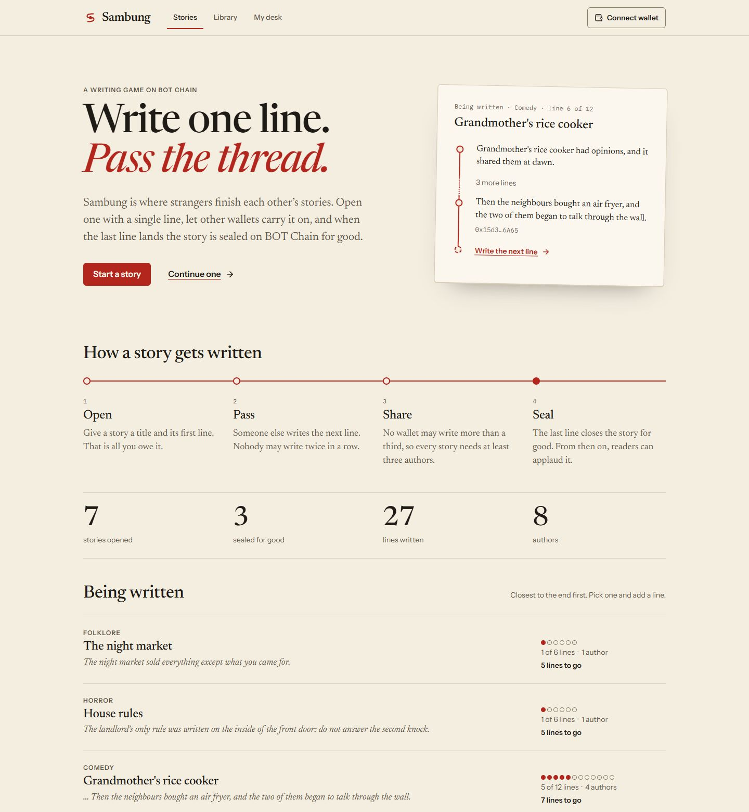
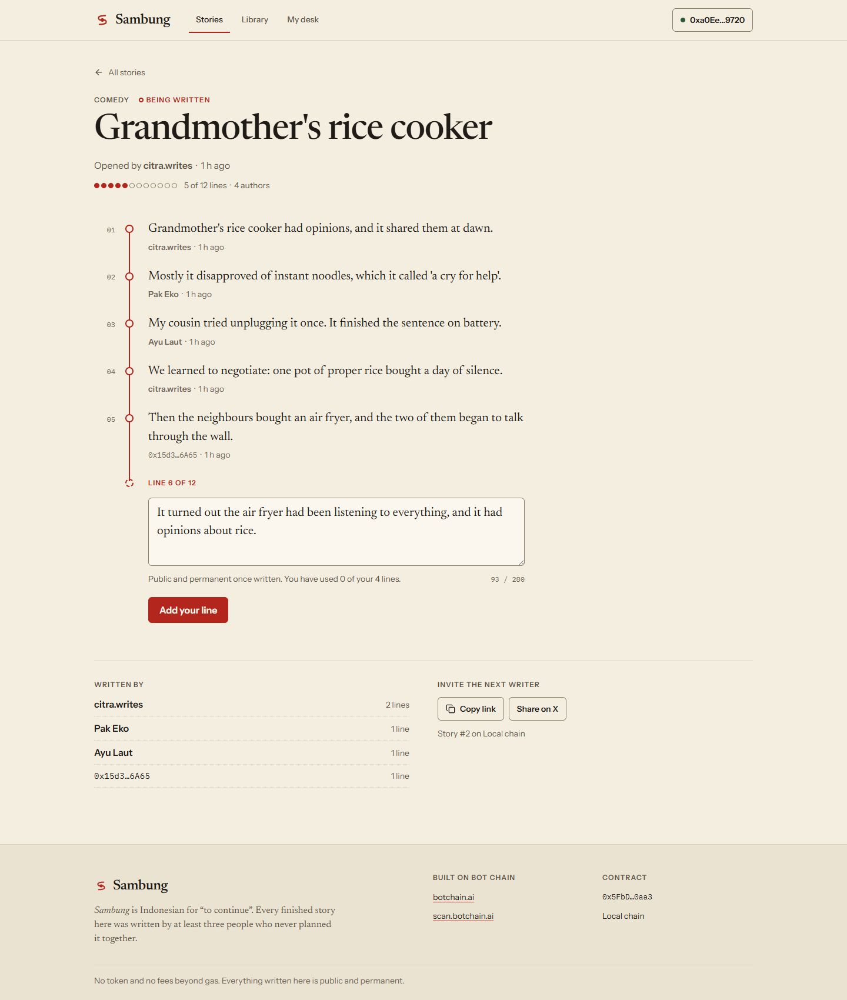
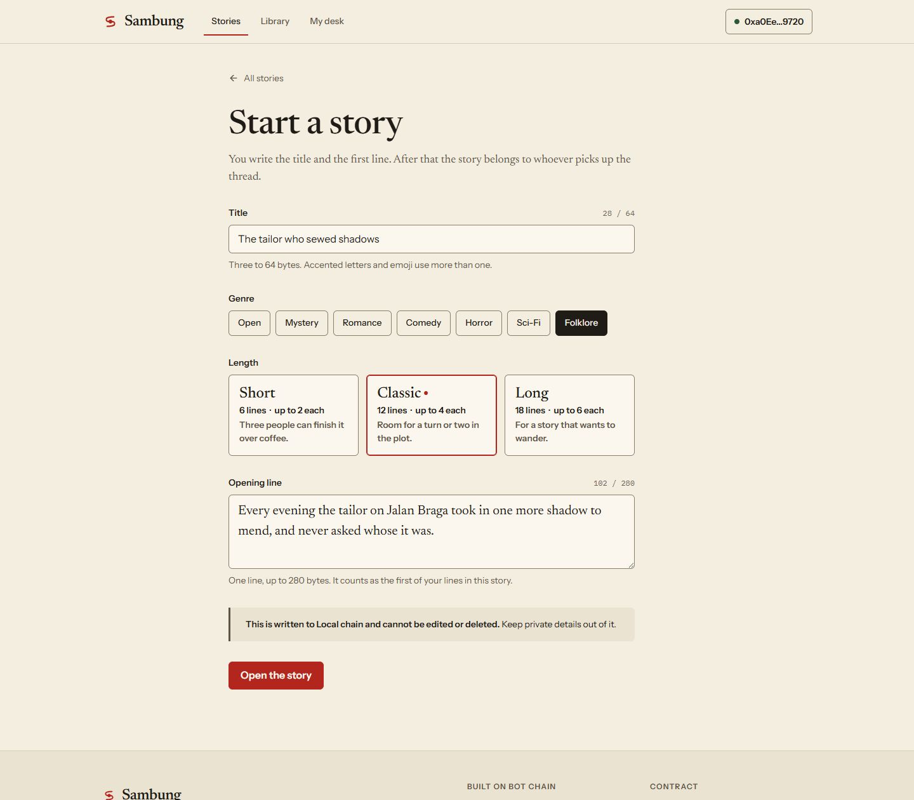
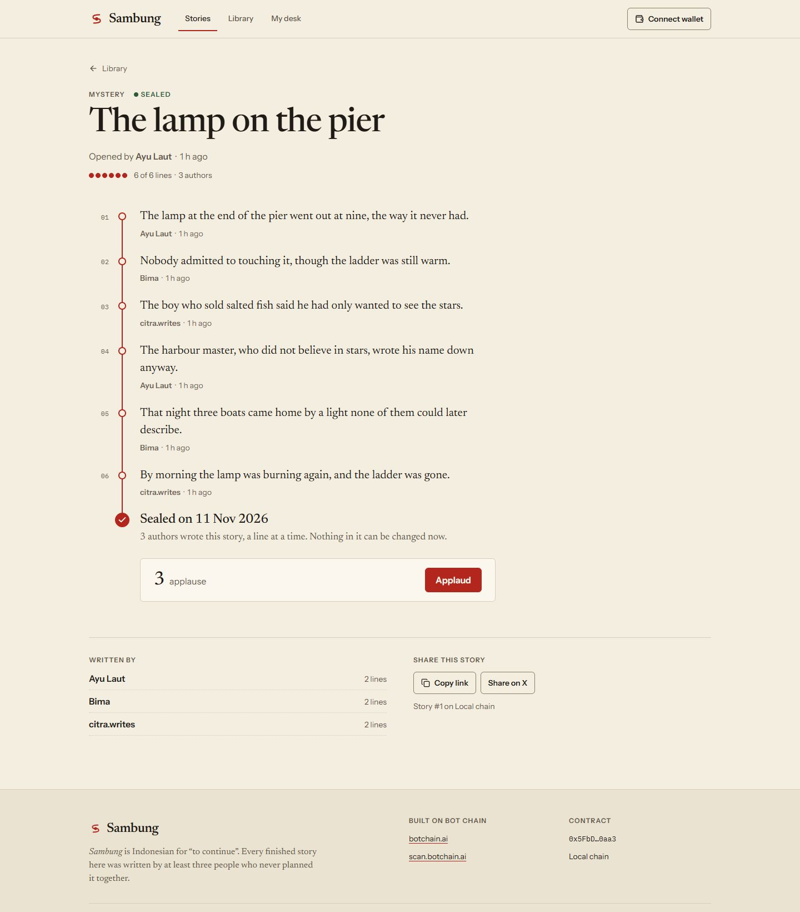
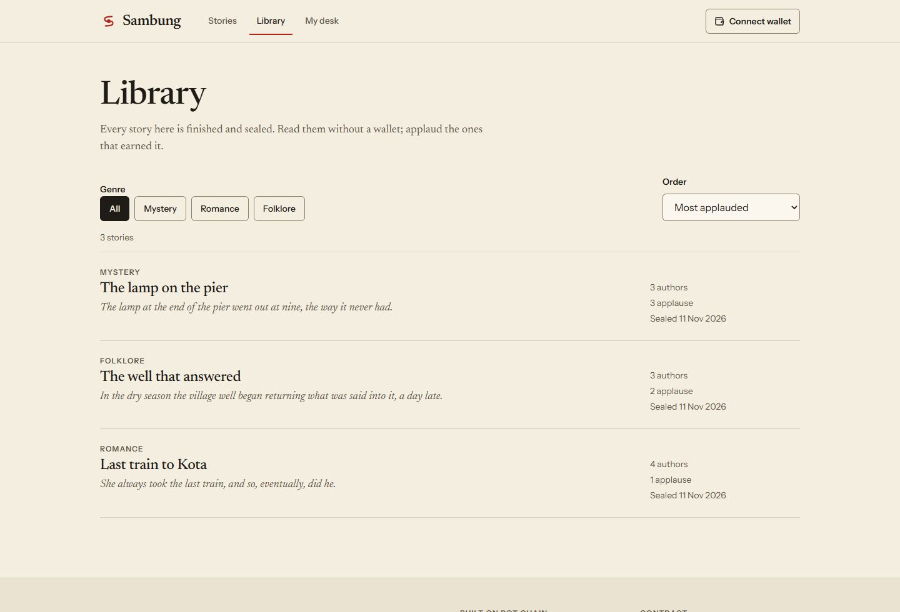
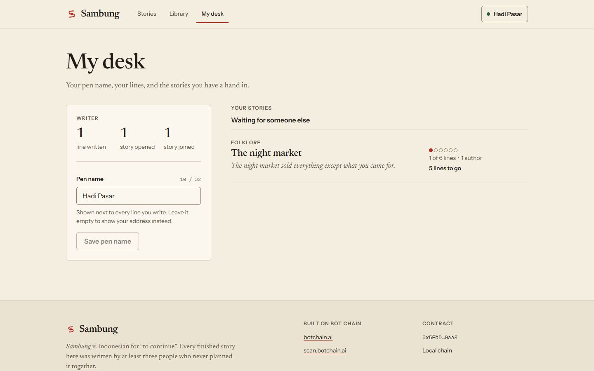
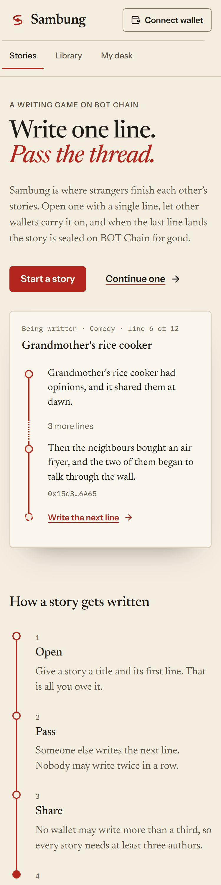
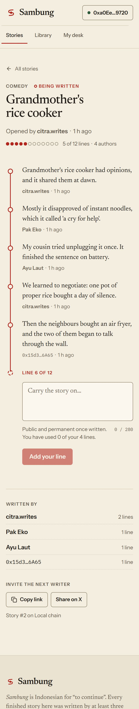
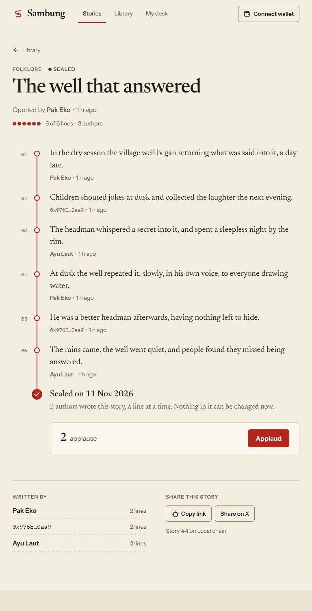

# Sambung

Stories written one line at a time, on BOT Chain.

Someone opens a story with a title and a first line. Other wallets carry it on, one line per turn. Nobody may write twice in a row, and nobody may write more than a third of a story, so every finished story has at least three authors. When the last line lands, the story is sealed for good and readers can applaud it.

*Sambung* is Indonesian for "to continue".

- Product scope and decisions: [PRD.md](PRD.md)
- Where the project stands: [PROGRESS.md](PROGRESS.md)
- Network: BOT Chain Mainnet, chain ID 677 — <https://botchain.ai> · <https://scan.botchain.ai>



## Screenshots

Taken from the local chain with the sample stories that `npm run seed:local` creates.

### Writing

| Continuing a story | Starting one |
|---|---|
|  |  |

### Reading

| A sealed story | Library |
|---|---|
|  |  |

| My desk |
|---|
|  |

### Phone and tablet

| Home at 375 px | A story at 375 px | A sealed story at 768 px |
|---|---|---|
|  |  |  |

## Layout

```
sambung/
├── contracts/   Hardhat project: Sambung.sol, tests, deploy and seed scripts
├── web/         Vite + React + TypeScript + viem front end
└── docs/        Screenshots used in this README
```

## Run it locally

Requires Node 22.

```bash
# 1. A local chain (leave it running)
cd contracts
npm install
npx hardhat node
```

```bash
# 2. In a second terminal: deploy, then add sample stories
cd contracts
npm run deploy:local
npm run seed:local
```

```bash
# 3. In a third terminal: the web app, at http://localhost:5173
cd web
npm install
npm run dev
```

On the local chain the wallet dialog lists four "Dev wallet" accounts. They ask the Hardhat node to sign, so you can write, pass the turn and seal a story without a browser extension. They exist only in the dev server; production builds do not contain them.

## Checks

```bash
cd contracts && npm test          # 36 contract tests
cd web && npm run typecheck       # TypeScript
cd web && npm run build           # production build into web/dist
```

## Which network the web app uses

| `VITE_CHAIN` | Network | Used by default in |
|---|---|---|
| `local` | Hardhat node, chain 31337 | `npm run dev` |
| `testnet` | BOT Chain Testnet, chain 968 | — |
| `mainnet` | BOT Chain Mainnet, chain 677 | `npm run build` |

Contract addresses live in `web/src/config/deployments.json`. The deploy script fills in the right entry. Until an address is present for the active network, the site shows a "not deployed yet" notice instead of stories.

## Deploy the contract

The deployer key stays on your machine.

```bash
cd contracts
cp .env.example .env      # then put the deployer key in .env as PRIVATE_KEY=0x...
npm run deploy:testnet    # BOT Chain Testnet (968) — test BOT from https://faucet.botchain.ai/basic
npm run deploy:mainnet    # BOT Chain Mainnet (677)
```

Deploying costs about 0.043 BOT at 20 gwei. Each deploy writes `contracts/deployments/<network>.json` and updates `web/src/config/deployments.json`; commit both so the site picks up the address.

Do not deploy to mainnet before the project's group exists: the program does not count projects that were on mainnet earlier.

## Host the web app on Vercel

| Setting | Value |
|---|---|
| Root Directory | `web` |
| Framework Preset | Vite |
| Build Command | `npm run build` |
| Output Directory | `dist` |

No environment variables are needed for mainnet. Routes are hash-based (`#/story/3`), so no rewrites are required.

## What the contract costs to use

Measured in the test suite with 140-byte lines, at 20 gwei:

| Action | Gas | BOT |
|---|---|---|
| Deploy | 2,147,544 | 0.043 |
| Open a story | 435,189 | 0.0087 |
| Add a line | 297,689 | 0.0060 |
| Applaud | 77,843 | 0.0016 |

The contract holds no funds and has no payable function.
